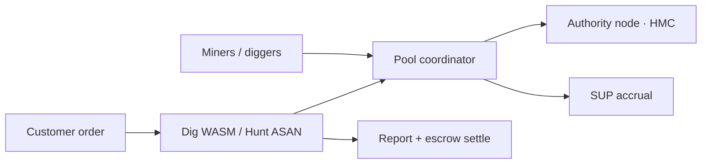

<div align="center">

<pre aria-label="HackMe Network ASCII logo">
██╗  ██╗ █████╗  █████╗ ██╗  ██╗███╗   ███╗███████╗    ███╗   ██╗███████╗████████╗██╗    ██╗ ██████╗ ██████╗ ██╗  ██╗
██║  ██║██╔══██╗██╔════╝██║ ██╔╝████╗ ████║██╔════╝    ████╗  ██║██╔════╝╚══██╔══╝██║    ██║██╔═══██╗██╔══██╗██║ ██╔╝
███████║███████║██║     █████╔╝ ██╔████╔██║█████╗      ██╔██╗ ██║█████╗     ██║   ██║ █╗ ██║██║   ██║██████╔╝█████╔╝
██╔══██║██╔══██║██║     ██╔═██╗ ██║╚██╔╝██║██╔══╝      ██║╚██╗██║██╔══╝     ██║   ██║███╗██║██║   ██║██╔══██╗██╔═██╗
██║  ██║██║  ██║╚██████╗██║  ██╗██║ ╚═╝ ██║███████╗    ██║ ╚████║███████╗   ██║   ╚███╔███╔╝╚██████╔╝██║  ██║██║  ██╗
╚═╝  ╚═╝╚═╝  ╚═╝ ╚═════╝╚═╝  ╚═╝╚═╝     ╚═╝╚══════╝    ╚═╝  ╚═══╝╚══════╝   ╚═╝    ╚══╝╚══╝  ╚═════╝ ╚═╝  ╚═╝╚═╝  ╚═╝
</pre>

# HackMe Network

**Your computer finds real security bugs. You get paid for it.**

HackMe is a mining network where rigs run fuzzing jobs ordered by developers — and earn HMC for verified pool shares (share-PPS) and Dig/Hunt useful work, plus a bounty share when they find a crash.

<br/>

[](https://hackme.tech/downloads.html)
[](https://hackme.tech/pool/coordinator/api/pool/stats)
[](https://github.com/jokeez/hackme/actions/workflows/ci.yml)
[](LICENSE)

<br/>

**[Downloads](https://hackme.tech/downloads.html)** ·
**[Quick start](docs/QUICK_START.md)** ·
**[Mine](docs/SETUP.md)** ·
**[Fuzz / Dig · Hunt](https://hackme.tech/developers.html)** ·
**[Exchange](https://exchange.hackme.tech/)** ·
**[Research](https://hackme.tech/research.html)** ·
**[Docs](docs/INDEX.md)**

</div>

---

## What it is

| Lane | You get |
|------|---------|
| **Mine** | Public HTTP pool · CUDA / OpenCL / CPU · hybrid Ed25519 submits · **HMC** share-PPS · **SUP** loyalty |
| **Dig** | Customer packs (Scan / Audit / Deep) · pool workers · report + CI gate · unused bounty refunded |
| **Hunt** | Coverage-guided fleet (libFuzzer · AFL++ Heavy) · Lite / Standard / Heavy · report + escrow |
| **Exchange** | Early access desk at [exchange.hackme.tech](https://exchange.hackme.tech/) — live matching + HMC/SUP custody; not a CEX listing |
| **Research** | Public ledgers (Hunt Watch, OSS CVE Watch, Bitcoin30) — evidence, not hype |



Payout follows **accepted work**, not lottery blocks. Model: [NETWORK_MODEL.md](docs/NETWORK_MODEL.md).

---

## Status · 0.1.0-rc18 LIVE

| Area | State |
|------|--------|
| **Installers** | Win · Linux · `.deb` · Dig/Hunt CLI · HackMe OS ISO + **SHA256SUMS** |
| **Pool** | Live coordinator · hybrid signer · **Blake3 + ASERT** · **SHARE_STRICT** solvency M · wall-rate GH/s (not pre-cliff calib) |
| **Settlement** | Go settler + SQLite units · day budget persisted · `/api/settlement/canonical.json` for desktop merge |
| **Checkpoints** | Daily signed tip+ledger · OpenTimestamps · [hackme-checkpoints](https://github.com/jokeez/hackme-checkpoints) · [ops note](docs/internal/CHECKPOINTS.md) |
| **Dig / Hunt** | Live product rails · coverage-guided Hunt fleet · report + CI gate |
| **Exchange desk** | Early access live · **not** a CEX, **not** financial advice |
| **Hunt Watch 2026sep** | **12/12 closed** · [ledger](https://hackme.tech/reports/hunt-watch-2026sep/) |
| **OSS CVE Watch** | nghttp2 **14/14** · libheif **14/14** CLEAN ledgers |
| **HMS storage** | Preview only — not a miner lane |
| **Economics v2** | **Soft announce** (design lock) — [RFC](docs/RFC_ECONOMICS_V2.md) · [news](https://hackme.tech/news.html#2026-10-30-economics-v2-soft-announce) · **not** height-activated yet |
| **D1 pool mint** | **Live on hub:** empty PoH finds → `solve-baseline` → settlement float (`LOCAL_POH=0`, `BASELINE_RELAY=on`) — soak before v2 height switch |

Channel: **0.1.0-rc18.x** — [docs/releases/](docs/releases/) · [docs/INDEX.md](docs/INDEX.md) · news: https://hackme.tech/news.html · prior rc17: [docs/archive/rc/HACKME_RC17.md](docs/archive/rc/HACKME_RC17.md)

**Honesty:** Hunt/Dig **CLEAN ≠ CVE claim**. Customer value is **bugs in their target + report + escrow**, not “we mint CVEs.” Standalone libFuzzer still wins **raw local exec/s**; product Hunt ships the **same engine class on the pool** (prove + escrow + Dig hybrid) — live bench 2026-10-11 in [HUNT_VS_LIBFUZZER.md](docs/HUNT_VS_LIBFUZZER.md). Old byte “~100 vs ~700 exec/s” charts are **not** the fleet default.

---

## Quick start

<table>
<tr>
<td width="33%" valign="top">

### Linux

```bash
# Recommended: release tarball
# https://hackme.tech/downloads.html  → verify SHA256

# Or from source
git clone https://github.com/jokeez/hackme.git
cd hackme
cp .env.desktop.example .env.desktop
bash scripts/ops/desktop_mode_up.sh
```

Dashboard → **http://127.0.0.1:8080** · [SETUP.md](docs/SETUP.md)

</td>
<td width="33%" valign="top">

### Windows

1. [Download installer](https://hackme.tech/downloads.html)
2. Verify **SHA256**
3. Start **HackMe Miner**

[Windows guide →](docs/MINER_WINDOWS_ONE_CLICK.md)

</td>
<td width="33%" valign="top">

### HackMe OS

Flash the **rc18** ISO → boot → wallet + mining.

```bash
bash scripts/tests/verify_hackme_iso.sh your.iso
```

[OS guide →](docs/HACKME_OS.md)

</td>
</tr>
</table>

Pool join: set `HACKME_PUBLIC_AUTHORITY_BASE=https://hackme.tech` (see [OPEN_POOL_MINERS.md](docs/OPEN_POOL_MINERS.md)).  
GPU backends: [GPU_MINING_BACKENDS.md](docs/GPU_MINING_BACKENDS.md).

---

## Dig & Hunt (customers)

| Product | Escrow | What you buy |
|---------|--------|----------------|
| **Dig · Scan / Audit / Deep** | 20/80 smoke · 40/60 Deep | WASM campaign on *your* guards · pool-distributed Dig (no AFL/LF in Dig) |
| **Hunt · Lite / Standard / Heavy** | 50/50 | **Coverage-guided** libFuzzer / AFL++ on the pool · coordinator **ASAN + afl-showmap** prove · escrow report — distributed Hunt, **not** an OSS-Fuzz replacement |

```bash
hackme-fuzzing wizard --pack filter_utf8 --package audit
hackme-fuzzing hunt … --package hunt_lite   # see docs
bash scripts/ops/install_hunt_engines.sh --desktop   # clang + AFL++ + bwrap (auto-install on published rc18 installers)
```

| Dig package | ~HMC | Runs (guide) |
|-------------|------|----------------|
| Scan | 1 | 64 |
| Audit | 5 | 256 |
| Deep | 40 | 2048 · 40/60 (hub Deep capped at 256) |

| Hunt package | ~HMC | Engine (default) |
|--------------|------|------------------|
| Lite | 20 | libFuzzer fleet wall |
| Standard | 60 | libFuzzer fleet wall |
| Heavy | 150+ | AFL++ when present |

Pay: proven showmap edges and/or ASAN crash = full PayRun; CLEAN without delta = floor. Byte fallback OFF. Linux miners: engines install on `install_hackme` / `update_hackme_miner` / firstboot (opt-out `HACKME_SKIP_HUNT_ENGINES=1`).

- Landing: [developers.html](https://hackme.tech/developers.html) · [fuzz-guide.html](https://hackme.tech/fuzz-guide.html)
- [HUNT_COVERAGE_ENGINES.md](docs/HUNT_COVERAGE_ENGINES.md) · [HUNT_VS_LIBFUZZER.md](docs/HUNT_VS_LIBFUZZER.md) · [FUZZ_PRODUCT_GUIDE.md](docs/FUZZ_PRODUCT_GUIDE.md) · [HUNT_ECONOMICS.md](docs/HUNT_ECONOMICS.md)

Bootstrap smoke orders prove the rail — they are **not** a paid Lite/Standard depth buy.

---

## Research

| Series | Hub |
|--------|-----|
| **Hunt Watch 2026sep** | [hunt-watch-2026sep/](https://hackme.tech/reports/hunt-watch-2026sep/) |
| **Bitcoin30** | [bitcoin30.html](https://hackme.tech/reports/bitcoin30.html) |
| **OSS CVE · nghttp2** | [oss-cve-watch/](https://hackme.tech/reports/oss-cve-watch/) |
| **OSS CVE · libheif** | [oss-cve-watch-libheif/](https://hackme.tech/reports/oss-cve-watch-libheif/) |
| **Index** | [research.html](https://hackme.tech/research.html) |

---

## Ecosystem

| Asset | Role | Status |
|-------|------|--------|
| **HMC** | PoW + pool settlement | Live |
| **SUP** | Support accrual while mining | Live |
| **Exchange** | Soft-launch desk (matching + HMC/SUP custody) | Live (USDT watch + Didit KYT TM; `HOT_SEND=0`) |
| **HMS** | Storage / seal epochs | Preview |

---

## Build & verify

```bash
go build -trimpath -o hackme-node .
go build -trimpath -tags opencl -o workerpoh-opencl ./cmd/workerpoh
go test ./...
bash scripts/tests/public_site_smoke.sh
bash scripts/tests/version_consistency_gate.sh
```

Release: `VERSION=0.1.0-rc18 bash scripts/release/make_release_bundle.sh` — [scripts/release/README.md](scripts/release/README.md)

---

## Config & trust

| | |
|--|--|
| Local desktop | `.env.desktop` (from `.env.desktop.example`) |
| Secrets | `.secrets/*` — **never commit** · [SECURITY_REPO.md](docs/SECURITY_REPO.md) |
| Official site | **https://hackme.tech** only |
| Downloads | Always verify **SHA256** on [downloads.html](https://hackme.tech/downloads.html) |
| Disclosure / bounty | [contacts.html](https://hackme.tech/contacts.html) · [BUG_BOUNTY.md](docs/BUG_BOUNTY.md) |
| Threat model | [docs/SECURITY.md](docs/SECURITY.md) |

Docs map: [docs/INDEX.md](docs/INDEX.md) · API: [docs/API.md](docs/API.md) · Architecture: [docs/ARCHITECTURE.md](docs/ARCHITECTURE.md)

---

## Contributing

[CONTRIBUTING.md](CONTRIBUTING.md) · AGPL-3.0 · [TRADEMARK.md](TRADEMARK.md) · no secrets in git.

---

<div align="center">

**HackMe Network** — Dig/Hunt useful fuzz + Blake3 share-PPS, open code, honest scope.

<br/>

[](https://t.me/hackme_tech)
[](https://bitcointalk.org/index.php?topic=5583373.0)
[](https://github.com/jokeez/hackme)

<br/>

<sub>Copyright © 2026 HackMe contributors · <a href="LICENSE">AGPL-3.0</a> · Not financial advice</sub>

</div>
